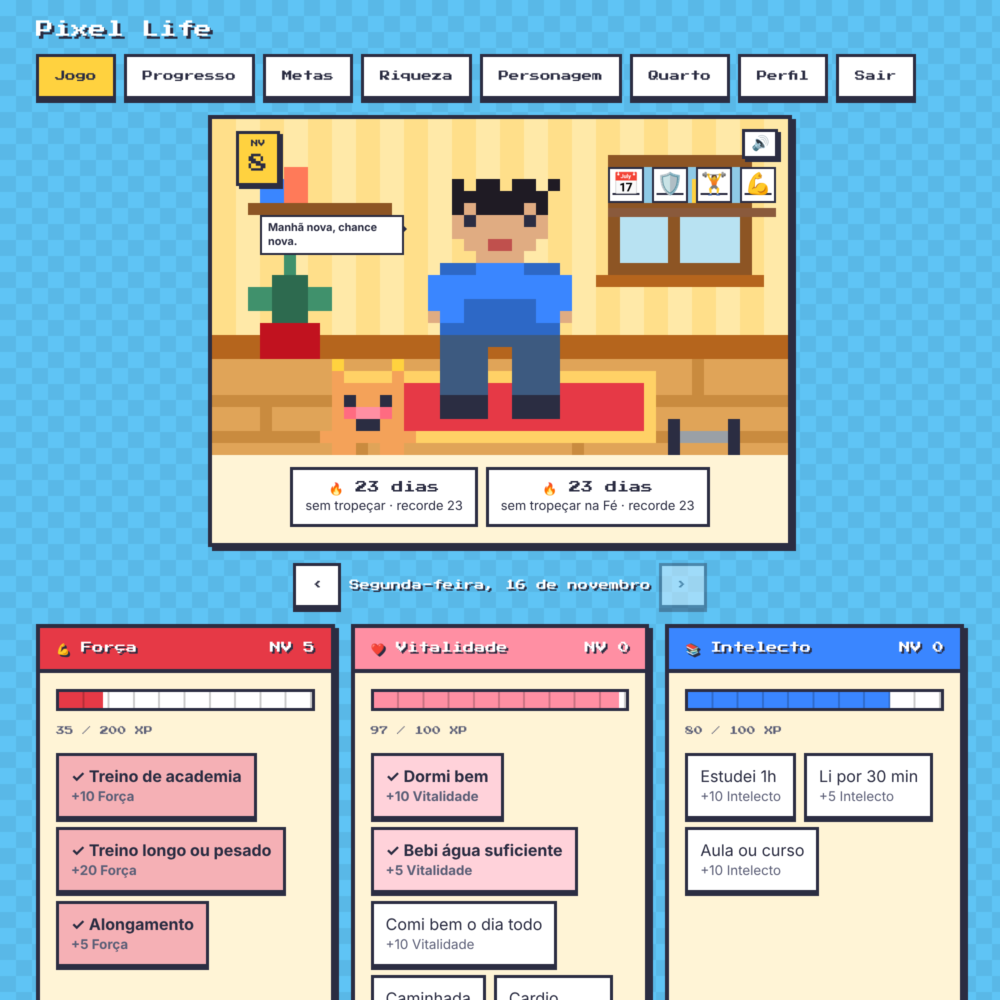
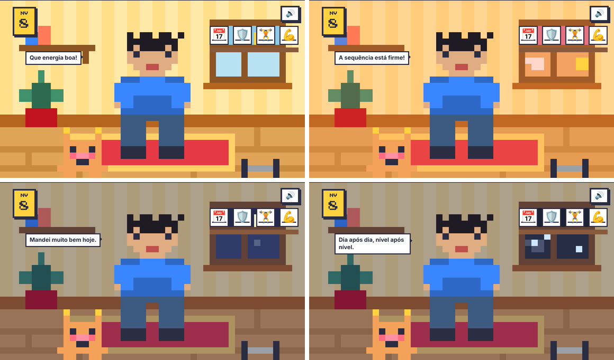
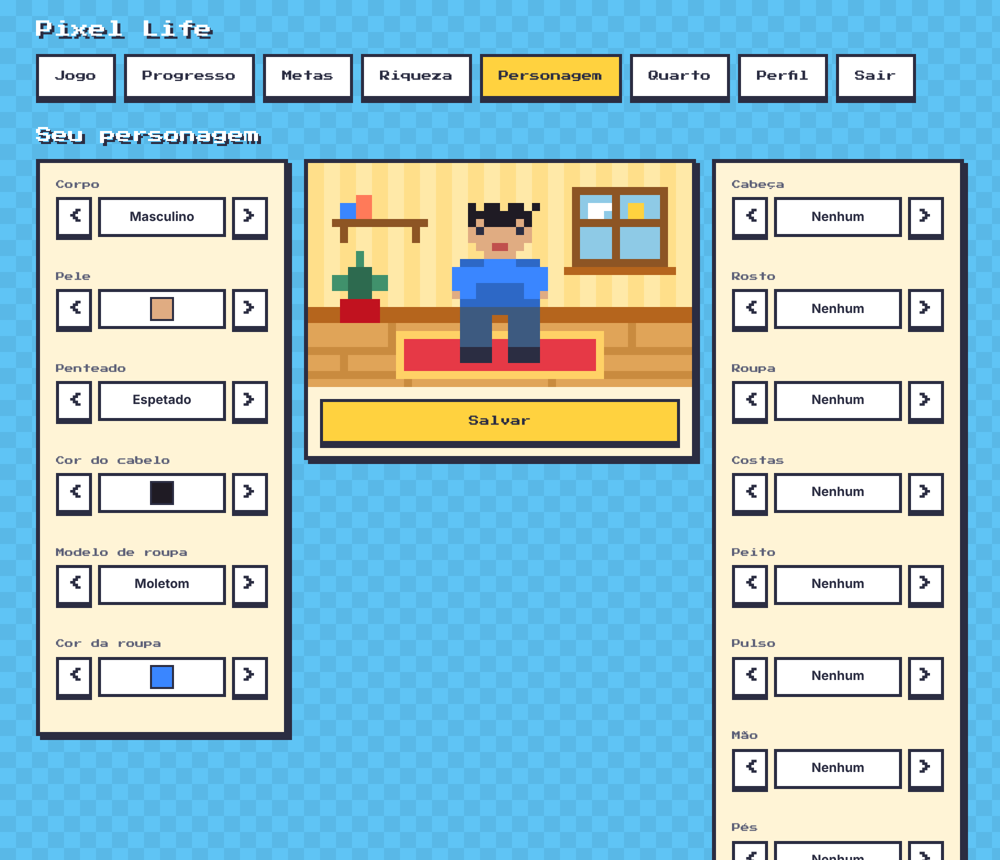
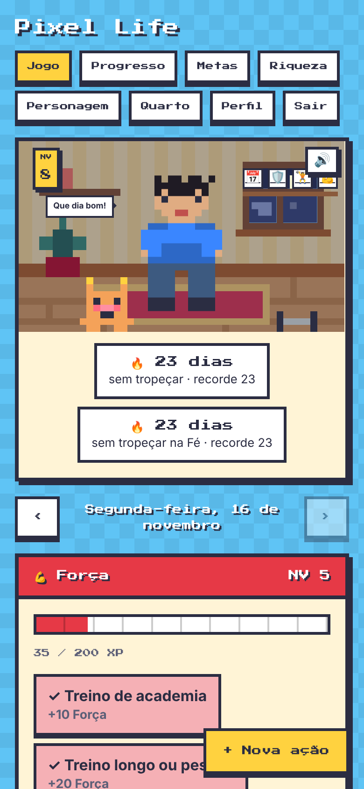

# Pixel Life

Jogo web de estilo idle/arcade em pixel art em que **o personagem é você mesmo**. Você registra o que fez no dia (treinar, estudar, orar, guardar dinheiro...) e o personagem evolui de verdade, sem precisar jogar: a vida real é o controle.

> Projeto pessoal, feito para ser simples de ler: Flask + HTML + CSS, com o mínimo de JavaScript.

**Demo:** https://pixel-life-indol.vercel.app



O cenário muda com a hora e com o humor do mascote (sol, nuvens, chuva; dia, entardecer, noite):



## O que tem

- **9 atributos** com níveis e XP: Força, Vitalidade, Intelecto, Foco, Carreira, Riqueza, Carisma, Equilíbrio e Fé.
- **Registro diário** de ações (prontas ou criadas por você), com sequências (streaks) e tropeços que pesam na evolução.
- **Personagem customizável** em pixel art: corpo, cores, 3 penteados e 3 roupas por corpo, e itens que se liberam conforme você evolui. Setinhas mudam cada peça; as bloqueadas mostram o que falta.
- **Quarto e mascote** (gato ou cachorro) personalizáveis; o quarto muda com o seu progresso, a janela mostra o céu da hora real e o mascote reage ao seu humor. O personagem fala frases variadas conforme o momento do dia e a sequência.
- **7 estilos de cores** à escolha no Perfil (Clássico, Noite, Portátil, Algodão-doce, Floresta, Pôr do sol, Fliperama), salvos na conta.
- **Efeitos e sons** ao registrar (faíscas, XP flutuante, confete, level up), com botão para silenciar e respeito a `prefers-reduced-motion`.
- **Conquistas**, **metas semanais** e **resumo/evolução** com gráfico.
- **Riqueza real**: controle de saldo em reais com gráfico por dia.
- **Contas com login** e cadastro público: usuário único, regras de senha, código de recuperação, limite de tentativas, alteração de senha e exclusão de perfil.





## Segurança

- Senhas com hash; código de recuperação só em hash, mostrado uma única vez.
- Limite de tentativas por usuário, por origem e de cadastros.
- Cabeçalhos de segurança (CSP, X-Frame-Options, nosniff, HSTS), cookie seguro e bloqueio de requisições vindas de outro site.
- Página de privacidade em `/privacidade`.

## Stack

- Python 3 e Flask 3 (app factory), Flask-SQLAlchemy.
- SQLite no desenvolvimento e Postgres em produção.
- Front-end com HTML, CSS e módulos ES simples, sem frameworks. Os sprites e o quarto são SVGs gerados no servidor.
- Testes com pytest.

## Como rodar localmente

```bash
python -m venv venv
# Windows: venv\Scripts\activate    |    Linux/macOS: source venv/bin/activate
pip install -r requirements.txt
python run.py
```

Abra http://127.0.0.1:5000 e crie uma conta.

## Testes

```bash
pip install -r requirements-dev.txt
python -m pytest -q
```

## Estrutura

```
app/
  routes/      rotas (páginas e API), uma por assunto
  services/    regras do jogo (progresso, conquistas, metas, riqueza, quarto...)
  data/        regras e catálogos em JSON (atributos, itens, conquistas, quarto)
  models.py    tabelas
  config.py    configuração por variáveis de ambiente
templates/     páginas HTML
static/        CSS, JS e imagens
tests/         testes automatizados
index.py       entrada para o deploy na Vercel
docs/          plano do jogo e imagens do README
```

## Deploy (Vercel + Neon)

1. Suba o repositório no GitHub e importe o projeto na Vercel (framework: Other).
2. Conecte um banco Postgres da Neon ao projeto (cria a `DATABASE_URL`). Escolha a região do banco mais próxima dos jogadores e mantenha a função na mesma região (`vercel.json`, hoje `gru1`), senão cada clique fica lento.
3. Defina as variáveis de ambiente:

| Variável | Para quê |
|---|---|
| `SECRET_KEY` | Chave da sessão (obrigatória na Vercel). |
| `DATABASE_URL` | Conexão com o Postgres. |
| `TIMEZONE` | Fuso do jogador (padrão `America/Sao_Paulo`). |
| `REGISTRATION_OPEN` | `0` fecha o cadastro de novas contas. |

## Licença

Projeto pessoal, sem licença definida.
